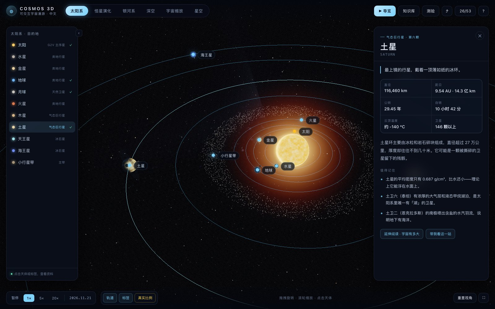
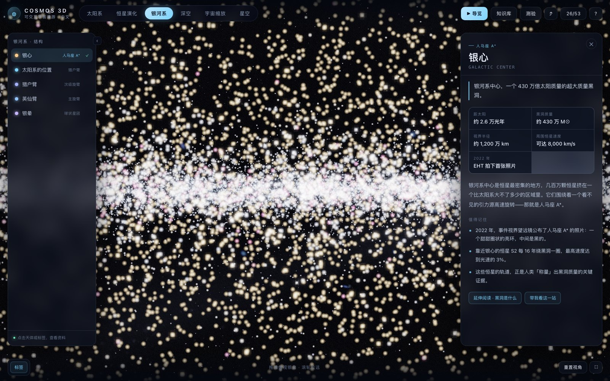
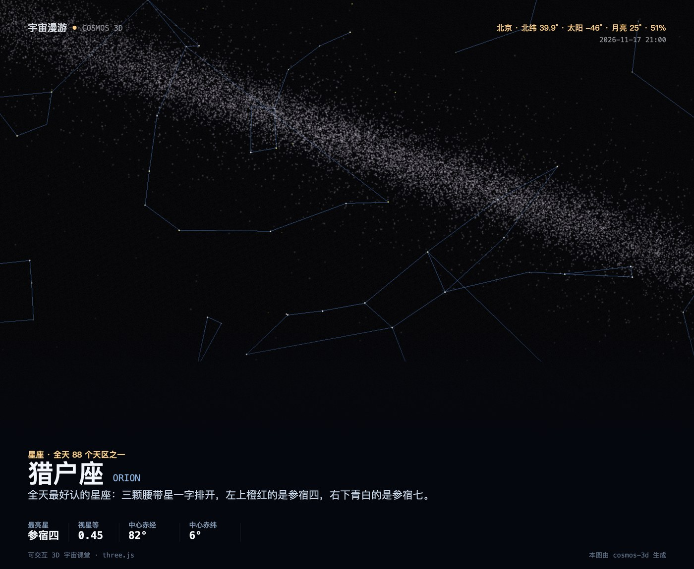

# 宇宙漫游 · COSMOS 3D

一个可以真正「走进去」的 3D 宇宙课堂：太阳系、恒星演化、银河系、深空、连续尺度缩放，以及用**真实星表**铺出来的星空与「今晚的天空」。

**在线预览** → https://szluyu99.github.io/cosmos-3d/

单文件、零后端、无账号，打开浏览器就能用。



## 六个场景

| 场景 | 内容 | 亮点 |
|---|---|---|
| **太阳系** | 太阳、八大行星、卫星、小行星带 | 可切「真实比例」：行星缩回真实尺寸，地球只剩 0.2 像素 |
| **恒星演化** | 分子云 → 原恒星 → 主序星 → 红巨星 → 白矮星 / 中子星 / 黑洞 | 赫罗图 + 可拖动的时间轴 |
| **银河系** | 旋臂、银心、太阳系位置 | 回答「我们在银河系的哪里」 |
| **深空** | 黑洞、蟹状星云、星系并合、类星体 3C 273、脉冲星、猎户座大星云、引力透镜、哈勃深场 | 事件视界、相对论喷流、灯塔射束、爱因斯坦环 |
| **宇宙缩放** | 从 1.7 米到 930 亿光年，17 个停靠点 | 一条可以用滚轮连续推拉的尺度轴 |
| **星空** | 2061 颗真实恒星、88 个星座 | 真实赤经赤纬；「今晚」按时间与城市还原此刻天象 |




## 星空与「今晚的天空」

- 星表来自 **HYG / d3-celestial**（J2000），恒星颜色由 B−V 色指数换算成真实色温；
- 银河用程序化光带着色器绘制，带暗尘带；下方滑块调**光污染**（0 级暗夜 → 5 级市中心），城市里银河会消失；
- 点「今晚」→ 按所选城市与时间，用天文历算把天球转到**你头顶此刻**的角度：太阳、月亮（真实相位与晨昏线）、水星到土星的位置都算出来，东南西北有方位标签，地平线以下被地面挡住；
- 滚轮放大到 30° 以下会浮现亮星的中文名。



## 学习闭环

- 每个天体都有：一句话描述、关键数据、3 条「值得记住」、延伸阅读；
- **学习进度**自动记录（localStorage）：探索 x/58、已读 x/10、导览 x/6、测验最佳 x/7；
- 测验答错会进「错题本」，可以只复习错的那几道；
- **尺度阶梯**：13 个停靠点，从人的身高到可观测宇宙，附光行时间；
- **分享一张图**：右上角 ⤴ 把当前画面导成 2400 px 海报（标题 + 数据 + 观测地点时间），可下载 JPG / PNG 或复制文案。

## 操作

| 操作 | 说明 |
|---|---|
| 拖动 | 旋转视角 |
| 滚轮 / 双指 | 缩放（星空里是改视场角，宇宙缩放里是连续推拉尺度） |
| 点击天体 | 侧栏显示资料 |
| `1`–`6` | 切换场景 |
| `S` | 太阳系真实比例 |
| `P` | 学习进度 |
| `空格` | 恒星演化 / 宇宙缩放里暂停或播放 |
| `R` | 重置视角 |

## 本地运行

直接双击 `index.html` 即可（`file://` 也能跑，脚本全部内联）。

想改代码：

```bash
cd src
# 编辑 js/ 与 style.css，然后打包成单文件
bash build.sh      # 输出到上一级目录的 cosmos-3d.html
```

`src/vendor/` 里是 `three.js r155 (UMD)` 与 `astronomy-engine 2.1.19`，均已本地化，不依赖 CDN。

## 技术

- **three.js r155**：自己写了轨道相机控制器、亮度提取 + 双向模糊的泛光管线（r155 官方 examples 不再提供 `examples/js`，所以全部手写）；
- **astronomy-engine**：太阳 / 月亮 / 行星的地平坐标、月相、恒星时；
- 点云星场用 GLSL 点精灵，按视星等调大小与透明度；
- 银河光带是球壳 + 3D 噪声 fbm 的着色器；
- 无构建工具、无框架、无网络请求，`index.html` 是唯一入口。

## 说明与边界

- 太阳系是**示意比例**（否则行星不可见）；「真实比例」模式下距离与直径都按真实值换算；
- 观测模式里天体直径**放大约 3 倍**，否则真实角直径不到 1 像素，点都点不到；
- 星表为 J2000，与今天的视位置差 < 1°（岁差），肉眼无感；
- 学习进度只存在浏览器本地，清缓存会丢。

## 许可

MIT
